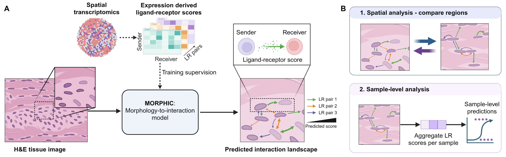

# MORPHIC

MORPHIC scores **directed, nearby cell pairs** for 1,821 ligand–receptor mechanisms using an H&E image. It uses frozen [UNI2-h](https://huggingface.co/MahmoodLab/UNI2-h) nucleus embeddings and the selected gated head in `models/morphic_head.pt`. RNA is used to construct training labels; inference needs only H&E and nuclei. Scores are raw sigmoid outputs, **not calibrated probabilities or proof of physical signaling**.



## Set up

Python 3.12 and a CUDA GPU are recommended. Install [uv](https://docs.astral.sh/uv/) and run from the repository root:

```bash
export UV_CACHE_DIR="$PWD/.cache/uv"
export HF_HOME="$PWD/.cache/huggingface"
uv sync --frozen
```

UNI2-h is gated. Visit the [UNI2-h model page](https://huggingface.co/MahmoodLab/UNI2-h), sign in with an institutional email, request access, and accept its terms. After approval, authenticate locally:

```bash
uv run --frozen hf auth login
```

Each user must obtain their own access. UNI2-h weights are not redistributed here. The download script checks their SHA256 against the weights used for this head. UNI2-h and models trained from its outputs are subject to its [noncommercial research terms](https://huggingface.co/MahmoodLab/UNI2-h).

## Run on a new H&E image

`--mpp` is the **microns represented by one full-resolution image pixel**. Use the scanner's value; an incorrect value changes crop size and pair distances. Input images must be RGB TIFF or OME-TIFF.

With automatic H&E nucleus segmentation:

```bash
uv run --frozen python scripts/download_data.py --skip-hest
uv run --frozen python scripts/infer.py --image /path/to/slide.ome.tif --mpp 0.5 --out outputs/slide
```

With an aligned integer nucleus label TIFF of the same width and height:

```bash
uv run --frozen python scripts/infer.py --image /path/to/slide.ome.tif --mpp 0.5 \
  --nuclei /path/to/nuclei.tif --out outputs/slide
```

With cell annotations, add `--annotations /path/to/cells.csv`. The CSV requires unique `cell_id,x_px,y_px` columns in full-resolution H&E pixel coordinates. Additional columns such as `cell_type` are carried into `cells.parquet`; **cell type is not an input to the model**. MORPHIC matches each annotation to a detected or supplied nucleus within 10 µm. Unmatched annotations are reported and omitted; duplicate matches cause an error. Cell boundary annotations can be exported as centroids in this CSV. If you also have nucleus outlines, convert them to the aligned label TIFF and pass `--nuclei`.

Inference writes `cells.parquet`, `edges.parquet`, `scores.parquet`, and `run.json`. `scores.parquet` contains sender ID, receiver ID, mechanism name, and uncalibrated score. A slide can yield many edge–mechanism rows; output is written in batches. Nuclei near the image boundary that cannot supply a complete 112 µm crop are omitted. Candidate pairs use the 40 µm radius and 12-neighbor rule. Nuclei are proxies for cells; the graph does not represent membrane contacts.

To score a reproducible percentage of cells, add `--sample-percent 10 --seed 17` to any inference command. The percentage selects anchor cells uniformly from the crop-ready detected or annotated cells; each anchor keeps its nearby neighbors and both pair directions, as in the sampled training graphs. Consequently, `cells.parquet` can contain more than 10% of eligible cells. The percentage, seed, eligible count, and anchor count are saved in `run.json`. Omit the option to use every eligible cell.

The small synthetic [inference example](examples/inference/README.md) checks the supplied-nuclei and cell-annotation inputs. Its scores have no biological meaning.

## Reproduce training

HEST files are downloaded from the pinned [HEST dataset](https://huggingface.co/datasets/MahmoodLab/hest) revision. The frozen `data/cohort.csv`, `data/anchors.csv.gz`, and `data/lr_catalog.csv` record the selected 37 training slides, six validation slides, nucleus anchors, and the LR thresholds fitted on the ten threshold-fitting training sections. Raw slides and intermediate files are large and are not committed.

```bash
uv run --frozen python scripts/download_data.py
uv run --frozen python scripts/preprocess.py --stage targets
uv run --frozen python scripts/preprocess.py --stage embeddings
uv run --frozen python scripts/train.py
uv run --frozen python scripts/evaluate.py
```

`preprocess.py` extracts 224 × 224 crops at 0.5 µm/pixel, forms directed candidate pairs, builds RNA proxy targets only for mechanisms measured by each panel, and caches frozen UNI2-h embeddings. `train.py` makes a complete pass over training graph edges per epoch, uses all positive and up to 16 uniformly sampled measurable negative mechanisms per edge, applies binary cross entropy plus 0.02 paired direction loss, and selects by validation binary Brier. It saves `outputs/trained/best.pt` and `history.json`. Seed and model settings are recorded in `configs/model.yaml`. The included `models/morphic_head.pt` is an earlier checkpoint (epoch 4) and not the output of these commands. It is not the checkpoint reported in the MORPHIC manuscript (epoch 3; SHA-256 `4871703f1fa58bf29cf6e4508cb03a1ec19d73f3d8dc35fac2d70bf236f96ecc`; settings in Supplementary Table S3), which will be added to this repository.

`evaluate.py` scores every edge in the six prepared validation graphs at its natural positive prevalence. It writes per-sample, per-mechanism `metrics.csv` and `summary.csv` with binary Brier, log loss, 20-bin ECE, AUROC, average precision, AP excess (AP minus prevalence), sender AP excess against the exact random-ranking expectation, and direction accuracy on discordant forward/reverse labels. AUROC, AP, and AP excess require at least five positive and five negative edges; Brier, log loss, and ECE include every measured mechanism. The reported scores remain uncalibrated. To evaluate the included released checkpoint instead of a newly trained one, use `uv run --frozen python scripts/evaluate.py --checkpoint models/morphic_head.pt --out outputs/released_evaluation`. The six validation samples were used for model selection, so these metrics are development validation, not an independent test.

For offline compute nodes, download and sync on a networked node, then use `uv run --frozen --offline`. Training and UNI2-h feature extraction require substantial GPU time and storage; preprocessing streams the large HEST transcript files and TIFFs.

## Provenance and terms

`models/manifest.json` records the included checkpoint and catalog hashes. The released checkpoint contains only the trained gated head; the UNI2-h encoder is fetched separately after individual access approval. The HEST dataset, UNI2-h model, and InstanSeg model retain their respective source terms. See their linked source pages before redistributing derived assets or using MORPHIC outside noncommercial research.
